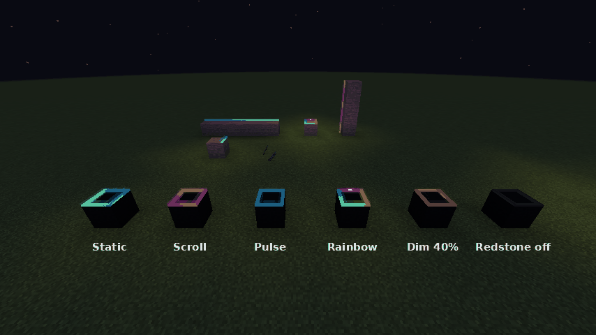
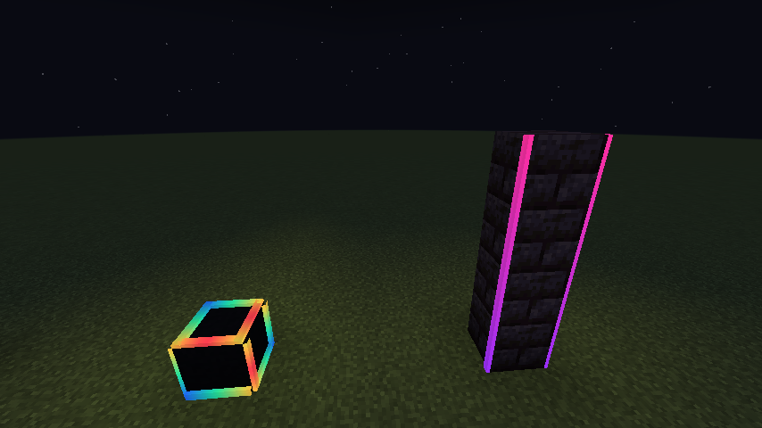
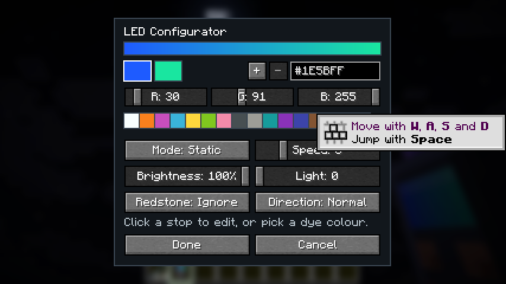
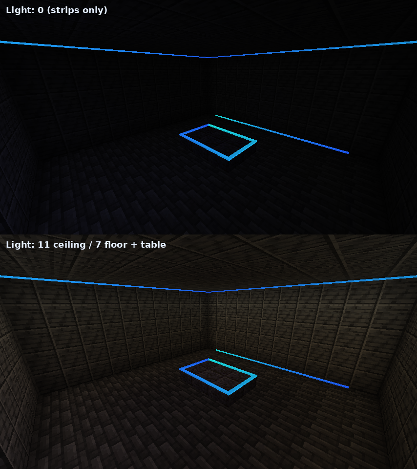
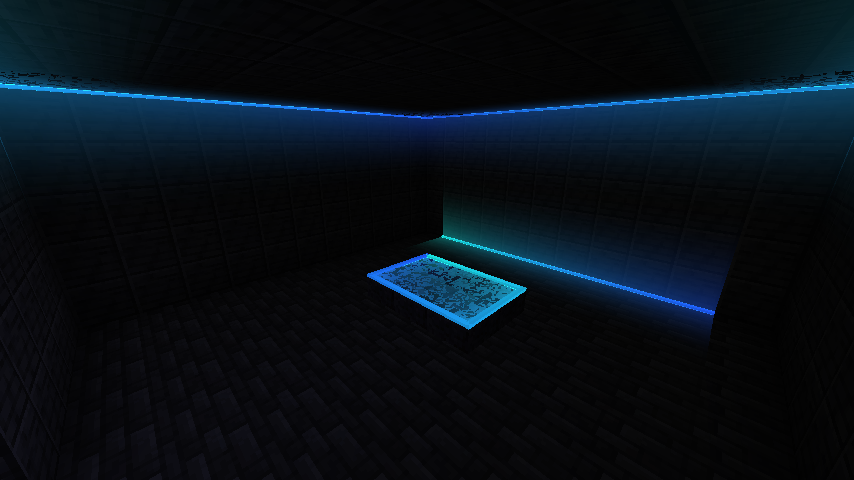
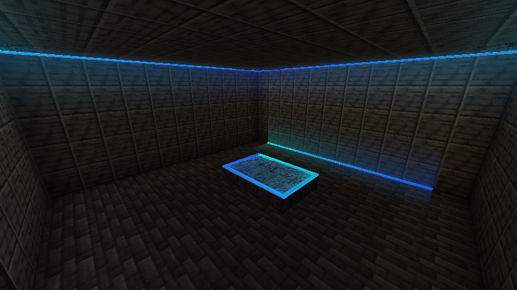

# Ledz - Customizable Led Lights/Strips

NeoForge mod for Minecraft 1.21.1 and 26.1.2. Stick LED strips on block edges and paint them with gradients using the LED Configurator.

*Static, Scroll, Pulse, Rainbow, Dim 40% and a redstone-controlled strip that is switched off.*

## LED Strip
- Use on a block face: the strip snaps to the nearest edge of that face. Up to 24 strips per block space (4 edges x 6 faces).
- Strips that touch end to end join into a **run**. The gradient spans the whole run, round corners and up walls.
- A new strip copies the look of a strip it touches, so runs keep going.
- Break one strip at a time. Strips pop off when their supporting block goes.

*All 12 edges of a block as one run, and strips up the corners of a pillar.*

## LED Configurator
- **Use in air**: open the editor. 2-4 colour stops (hex, RGB sliders or dye palette), live preview.
- **Use on a strip**: apply to its run. **Sneak-use**: copy that strip's look.
- Modes: Static, Scroll, Pulse, Rainbow. Speed, brightness, reverse.
- Light: 0-15 real block light.
- Colour wash: 0-100%. Tints nearby walls, floors and ceilings with the strip colour, fading out over 2.5 blocks (vanilla light is colourless, this fakes it).
- Redstone: ignore, on when powered, off when powered, or brightness by signal strength.

## Lighting a room

*Top: Light 0, the strips only glow. Bottom: Light set, the room is lit.*

| Colour wash 100%, Light 0 | Colour wash 70%, Light 11 |
|---|---|
|  |  |

## Recipes
- 8 LED Strips: glowstone dust + glass pane + copper ingot (shapeless).
- LED Configurator: amethyst shard over copper / redstone / copper, copper below.

## Versions
- `main`: Minecraft 1.21.1 (NeoForge 21.1).
- `mc/26.1.2`: Minecraft 26.1.2 (NeoForge 26.1.2).

## Build
`./gradlew build`. Textures: `python3 tools/textures.py` (needs Pillow).
